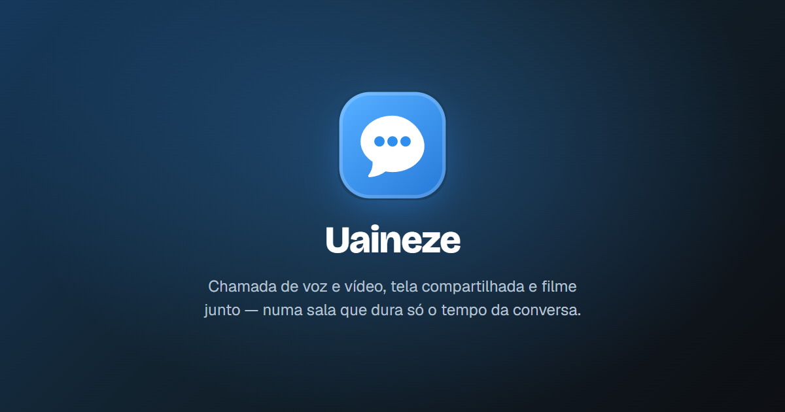

  

  

  Instalação em um minuto &nbsp;·&nbsp; Atualiza sozinho &nbsp;·&nbsp; Sem precisar de administrador

 

## O que é o Uaineze

Um espaço para ficar junto de quem você gosta, mesmo longe. Você cria uma sala, chama a galera e tem tudo num lugar só: conversa, chamada, tela compartilhada, filme e jogo.

<table>
  <tr>
    <td width="50%" valign="top">
       
      <strong>Conversa</strong> 
      Salas com canais de texto, mensagens diretas e lista de amigos. As mensagens aparecem na hora, com GIFs, reações e respostas.
    </td>
    <td width="50%" valign="top">
       
      <strong>Chamadas</strong> 
      Voz e vídeo com qualidade de chamada de verdade, compartilhamento de tela e cancelamento de ruído.
    </td>
  </tr>
  <tr>
    <td width="50%" valign="top">
       
      <strong>Assistir junto</strong> 
      Todo mundo vê a mesma coisa ao mesmo tempo, sincronizado. Pause, avance e volte, e a sala acompanha.
    </td>
    <td width="50%" valign="top">
       
      <strong>Jogos</strong> 
      Stop (Adedonha), Impostor, Lobisomem e outros para jogar na própria sala, com voz aberta.
    </td>
  </tr>
</table>

 

## Instalação

1. Abra a **[página da versão mais recente](https://github.com/derikolis/uaineze-releases/releases/latest)**.
2. Em **Assets**, baixe o arquivo `Uaineze_x.y.z_x64-setup.exe`.
3. Abra o arquivo e siga o instalador.

Você só instala **uma vez**. Depois disso, o app se atualiza sozinho.

**Requisitos:** Windows 10 ou 11, 64 bits.

 

## Atualizações automáticas

O Uaineze mantém você sempre na versão mais nova, sem baixar nada de novo.

<table>
  <tr>
    <td width="33%" valign="top">
       
      <strong>Procura</strong> 
      Ao abrir e a cada poucas horas, o app confere se há uma versão nova.
    </td>
    <td width="33%" valign="top">
       
      <strong>Baixa</strong> 
      Se houver, baixa em segundo plano, sem atrapalhar o que você está fazendo.
    </td>
    <td width="33%" valign="top">
       
      <strong>Avisa</strong> 
      Aparece "Atualização pronta" na barra do app. Você escolhe <em>Reiniciar agora</em> ou <em>Depois</em>.
    </td>
  </tr>
</table>

Cada atualização é **assinada digitalmente**: o app só instala arquivos que vieram de quem publica o Uaineze e recusa qualquer outro.

Para conferir na hora, clique na sua foto, no canto superior direito, e em **Verificar atualizações**. Ali também aparece a versão que você está usando.

 

## Perguntas frequentes

<strong>O Windows mostrou "O Windows protegeu o computador". É seguro?</strong>

 
Esse aviso (SmartScreen) aparece para programas novos que ainda não têm reputação no Windows. Ele não indica que o arquivo seja perigoso. Para continuar, clique em <strong>Mais informações</strong> e depois em <strong>Executar assim mesmo</strong>. Baixe sempre por esta página, que é a oficial.

<strong>Fechei a janela e o app continua aberto. É normal?</strong>

 
Sim. Fechar a janela só a esconde: o Uaineze continua na bandeja do Windows (perto do relógio) para você receber mensagens e chamadas. Para sair de verdade, clique com o botão direito no ícone da bandeja e escolha <strong>Sair do Uaineze</strong>.

<strong>Reiniciar para atualizar derruba a minha chamada?</strong>

 
Sim, reiniciar encerra a chamada em andamento. Por isso o app pergunta antes e deixa você escolher o momento. Se preferir, clique em <em>Depois</em> e atualize quando terminar de conversar.

<strong>Como desinstalar?</strong>

 
Em <strong>Configurações do Windows &gt; Aplicativos &gt; Aplicativos instalados</strong>, procure por Uaineze e escolha <strong>Desinstalar</strong>.

<strong>Encontrei um problema. Como aviso?</strong>

 
Dentro do app, clique na sua foto e em <strong>Reportar um bug</strong>. Assim o relato já vai com o contexto necessário.

 

---

  Este repositório guarda apenas as versões do aplicativo para Windows. Ele é abastecido automaticamente a cada nova versão e não precisa de nenhuma ação sua. O código-fonte do Uaineze não é público.

